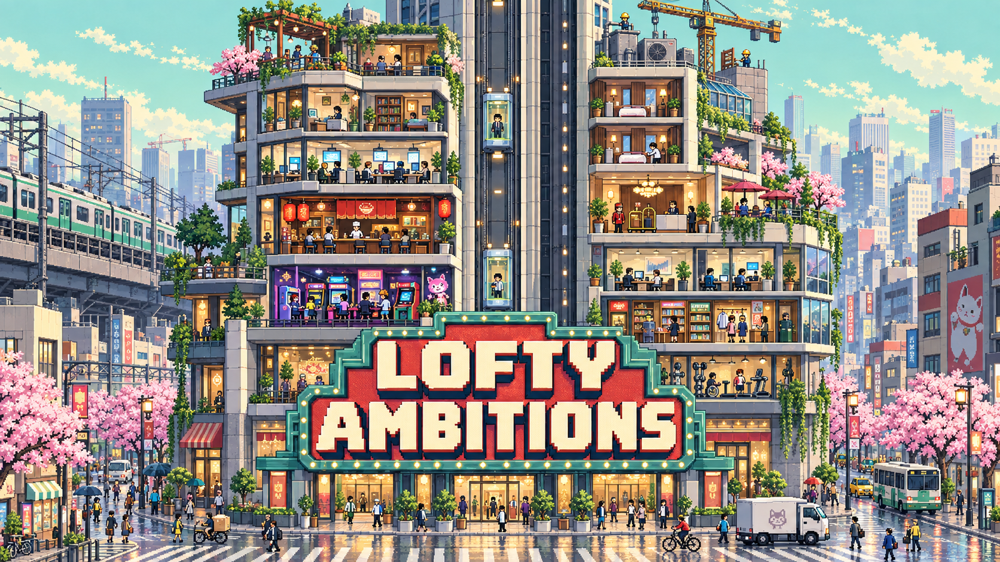

# Lofty Ambitions



A tower management game with Tokyo-inspired pixel artwork. Native macOS controls and a Windows desktop frontend share the same Swift game code, saves, scene rendering, and artwork.

The Windows port is ready for its first PC build and verification. See [Windows build instructions](docs/porting/WINDOWS.md); Windows execution and clean-machine packaging are still pending.

## Continue on Windows

Clone [chriswallace/Lofty-Ambitions](https://github.com/chriswallace/Lofty-Ambitions) and follow [the PC handoff](docs/porting/PC-HANDOFF.md). It records the Windows build instructions and pending Steam/security work.

## Play

Open **`dist/Lofty Ambitions.app`**. A zipped copy is at **`dist/Lofty-Ambitions-macOS.zip`**.

The game opens on the illustrated **Lofty Ambitions** title screen. Click **Enter Tower** or press Return to enter your restored tower (or a fresh tower if no autosave exists). Time stays paused on this screen.

For an immediately usable tall-tower experiment, open **`Examples/Express & Local.loftyambitions`** from the game’s File → Open menu. It is a 50-floor transport sandbox with standard, wide and express banks, unlocked facilities, and extra construction funds.

- Universal binary: Apple Silicon and Intel. Targets macOS 13 or later.
- Native Swift/AppKit, crisp Retina pixel graphics, no emulator, no network dependency.
- Local development build with an ad-hoc signature; not an Apple-notarized release.

### Room catalog and tools

The sidebar is dedicated to rooms: searchable pixel-art rows, category filters, and a detail panel with size, capacity, operating costs, income at full occupancy, and construction price. Clicking a room immediately selects it for placement; Esc cancels. Pricing is visible in the catalog row and on hover. Locked or unaffordable rooms show their requirements without starting construction. Search and category selection remain in place while time advances.

A compact toolbar keeps **Inspect / edit**, **Delete**, **Build**, **Issues**, **Tower**, **Save**, and **Focus** visible. The **Build** menu groups floor drawing, adding floors, widening left/right, all three elevator types, and shaft extensions. Inspectors show only the selected room or elevator; tower statistics and progression live in **Tower**. The macOS menu bar also has **View**, **Rooms**, and **Tools** menus.

### How to play

New towers start with only a ground-floor lobby and $180,000. Build your first floor, place rooms, and add an elevator to bring in tenants. Browse the room catalog on the left, click a room to select it for placement, and click an empty space to build. Search by name or purpose, or filter by category. Locked rooms stay browsable and show their level requirement. Drag or scroll to move around the tower. Pinch, hold ⌘ while scrolling, or press +/− to zoom toward the cursor. The footer zoom buttons keep the center of the view in place; **Fit** shows the whole tower.

Add floors, then **extend elevators** to give tenants access. Add more elevators when wait times rise. Inspect occupied rooms to adjust rent. Higher rent earns more per occupant but reduces demand. Hotels need housekeeping; security and gardens help larger towers thrive.

Cash settles at midnight. Earn permanent tower levels by reaching population, happiness, and service milestones. Each promotion awards a construction grant and unlocks facilities. Demolishing a room or elevator returns half its construction cost. Inspect an elevator to relocate its shaft for free; drag the new path and service floors, or press Esc to cancel.

The building site supports **100 floors above the lobby and 256 cells per floor**. There is no separate room quota: up to **6,400 apartments** can fit before allowing space for elevators. Larger room types reduce that total. Tower information shows these limits, and construction messages explain when a floor, width, or height limit is reached.

| Control | Action |
| --- | --- |
| Drag a room tool | Place a row of rooms |
| Drag Floor / lobby | Build or extend a floor |
| Drag an elevator tool vertically | Set the bank’s service floors |
| Option-drag | Pan while a tool is selected |
| Space | Pause / resume |
| 1 / 2 / 3 | 1× / 4× / 12× speed |
| I / Esc | Inspect / edit tool |
| X | Delete tool |
| ⇧⌘R | Search room catalog |
| Tab / ⇧⌘F | Toggle distraction-free mode |
| Esc in Focus | Restore the interface |
| F | Fit tower |
| + / − | Zoom |
| ⌘S | Save |
| ⌘O | Open a saved tower |
| ⌘N | Start a new tower |

Autosaves are stored at `~/Library/Application Support/LoftyAmbitions/Autosave.loftyambitions`, once a minute and on quit. Manual saves use JSON with the `.loftyambitions` extension. Earlier saves from this project can still be opened regardless of their extension; saving an imported tower asks for a new file and preserves the original.

Opening another tower or starting a new one offers Save Changes, Cancel, or Keep Recovery Copy when there are unsaved changes. The previous tower is preserved as a separate timestamped file under `~/Library/Application Support/LoftyAmbitions/Recovery`, even when the autosave later changes. Use **File → Recover a Tower…** to reopen a snapshot; save it to a new file to keep the recovery original.

## Tower levels and new rooms

Select the **Level** button or **Tower** to see a live milestone checklist, upcoming unlocks, and the full room roadmap. Levels never drop, grants are awarded once, and existing saves retain their earned star rating as their level.

| Level | Requirements | New unlocks |
| --- | --- | --- |
| 1 · Newcomer | Start a tower | Offices, apartments, restaurants, shops |
| 2 · Neighborhood | 220 people, 65% happiness | Hotels, housekeeping, café, ramen bar, **B1 excavation, Open House** |
| 3 · Destination | 500 people, 70% happiness, operational housekeeping | Security, sky garden, arcade, bookshop, Grand Lobby upgrade, **B2 excavation, Night Market** |
| 4 · City landmark | 900 people, 75% happiness, operational security | Fitness studio, coworking studio, luxury apartments, **B3 excavation** |
| 5 · Skyline icon | 1,400 people, 80% happiness, operational sky garden | Observation lounge, spa, **B4 excavation** |

Food and shopping now serve nearby neighborhoods with finite capacity. Homes, offices, coworking studios, and hotel guests each need one unit of food and shopping service per occupant. Food reaches **4 floors above and below**, shops **6**; both reach **48 grid cells horizontally**, measured between room centers. Restaurants serve 240 neighbors, cafés 120, ramen bars 180, shops 320, and bookshops 140. Shared venues divide their capacity among nearby demand, with overlapping venues picking up available demand. Providers require lobby access and no active incident; evening closing artwork does not suspend coverage.

Use **Coverage: Food** or **Coverage: Shops** in the toolbar to shade rooms while building: teal means full coverage, amber partial coverage, and red no coverage. Labels show percentages; blue venues show neighbors served / capacity, and gray rooms are empty or temporarily unable to receive service. Hover for the exact reason. Select an existing venue or move a matching construction tool to see a dashed reach guide on connected floors. The guide shows geometric reach, while the room colors continue to show current coverage; finite capacity still applies. Overlays stay selected across construction tools, hide temporarily in Focus, and can be switched off in the same selector. The Issues panel's “Add nearby” shortcuts activate the matching overlay.

Room inspectors show coverage percentages and distinguish absent service from exhausted capacity. Venue inspectors show neighbors served. **Issues** groups shortages by floor and offers **Add food nearby** / **Add shops nearby** actions that center the affected neighborhood and select a building tool. Tower information shows floor coverage. Shortages affect happiness and target occupancy through normal tenant movement, with no immediate eviction or lost earned levels. Vacant rooms show an estimate for full occupancy using spare capacity, without reserving service. Existing saves derive coverage automatically.

Required services must have elevator access and no active incident. Café and ramen bar meet food needs; the bookshop supplies retail in a compact footprint. Arcade, fitness, observation, and spa facilities add 2, 3, 4, and 3 percentage points of tower happiness respectively when operational and connected; multiple copies of the same facility do not multiply its benefit. Promotions award $20,000–$50,000. Every room has six independent artwork states and separate people. The new ramen bar, bookshop, coworking studio, spa, and Grand Lobby have solid side walls without exterior windows.

### Ambitions, abilities, and celebrations

The prompt above the room catalog keeps the next ambition visible. Open it or **Tower** for three current challenges: establish connected businesses, diversify the tower, carry elevator passengers, run a hotel, and create an underground district. Claim completed ambitions for one-time construction grants. Ten ambitions persist with the tower, including achieved but unclaimed goals and collected rewards. Older saves start with unclaimed ambitions and keep all earned levels.

**Open House** unlocks at level 2: pay $1,500 to double the incoming-tenant rate for 12 game hours. **Night Market** unlocks at level 3: with two connected, operational underground food or retail rooms, pay $250 for six game hours of +50% income in those basement businesses. Each ability can start again two game days after activation. Timers pause with the simulation and survive saving and loading; disabled buttons explain their requirements.

Promotions show an animated reward card with the new level, unlocks, development grant, and a confetti burst. Claiming an ambition or starting an event gets a smaller celebration. Cards can be dismissed or opened to progression details, and automatically clear after a few seconds. Reduce Motion replaces the burst and scale animation with a short fade.

### Underground districts

At level 2, use **Build → Excavate B1** or **Tower → Below the surface**. Each promotion grants one deeper permit through B4. Excavation costs $12,000 / $18,000 / $24,000 / $30,000, copying the width of the floor above. Each basement adds $60/day structural upkeep. The floor tool widens existing basements within the level above; excavation creates new ones. Widening the whole tower includes excavated basement floors in its quote.

Build food, shops, housekeeping, security, arcades, fitness studios, and spas below ground. Search **underground** in Rooms to find compatible rooms. Homes, workplaces, hotels, sky gardens, and observation lounges need an above-ground floor. Draw a standard or wide elevator from a basement to G or an existing served floor; express elevators remain above ground.

Connect operational food, retail, and an arcade anywhere underground to form a district: basement food and retail earn +15% while all three anchors remain operational. A Night Market can temporarily boost the district further. Basements have their own cutaway walls and B1–B4 labels, stay in place when the Grand Lobby rises, and use an interior fire response.

### Interior styles and luxury apartments

Offices and apartments each have three interiors. New builds choose a saved, repeatable random style that differs from touching rooms of the same type on either side. Select an existing room and use **Interior style → 1 / 2 / 3** to change it for free. Manual choices can match neighbors. Existing saves keep their original interiors until changed. A room with an active incident must be resolved before restyling; each style has its own vacant, open, closed, damaged, destroyed, and rebuilding art.

**Luxury apartments unlock at level 4:** $65,000 construction, 12 cells wide, capacity 16, $5,200/day rent at full occupancy, and $700/day upkeep. They share standard apartments’ screening, deposit, rent-dispute, and fire systems, with their own spacious interior.

Occupants are separate sprites placed at chairs, desks, beds, and sofas. Workers sit at desks, residents read, and residents stay in bed at night. Staggered short walks include pauses to stand and turn, keep feet on the floor, and stay clear of neighboring occupants. Footsteps follow distance traveled, and elevator travelers move smoothly between simulation updates. Vacant rooms, closed workplaces, and active fire scenes do not show ambient occupants. Activities pause with the game, and Reduce Motion keeps furniture poses still. These are visual samples of the population, separate from the elevator journey simulation.

For a disposable preview: `swift run --disable-sandbox LoftyAmbitions --fresh --interior-demo --screenshot /tmp/lofty-interiors.png --exit-after-screenshot`.

### Grand Lobby

At level 3, select the lobby or open **Tower** to purchase the **Grand Lobby** upgrade for $40,000. It creates a four-floor atrium (G–3) with marble reception, a chandelier, and upper galleries. Existing rooms and elevators move up three floors; ground-level shafts extend through the atrium and stop at G. Room contents, leases, and passenger trips are retained. It adds 3 percentage points of tower happiness and $250/day upkeep (total lobby upkeep $350/day). The upgrade is permanent, saved with the tower, and preserves the existing room layout above it. The tower must have three floors of headroom below the 100-floor limit, and active fires and repairs must be resolved first. Widening the ground lobby expands all four atrium levels and charges for each. Older one-floor Grand Lobby saves can expand for free through the same upgrade button.

### Delete confirmation

Deleting through the toolbar or inspector opens a confirmation naming the room/floor or entire elevator shaft, the 50% construction refund, and the consequences. Elevator removal reports how many rooms would lose access to the lobby. **Keep it** is the default keyboard action. The simulation pauses while the confirmation is open and resumes its previous speed afterward. Lobby removal and demolition during an active room incident remain blocked.

### Distraction-free mode

Select **Focus**, press **Tab** while viewing the tower, or use **View → Distraction-free mode** (⇧⌘F). The tower fills the window; a small strip keeps Play/Pause, Issues, and Exit focus available. Pan and zoom still work. Construction is cancelled when entering Focus, and clicking the scenery cannot build, delete, or edit rooms. **Esc** or **Exit focus** restores the interface; opening Issues restores it and opens the issue list. The camera zoom and simulation speed are preserved.

## Tower construction and simulation

The tower uses original Tokyo-inspired pixel-art interiors, separate character sprites and layered emergency effects. Source pixel sizes are independent of the eight-unit construction grid and 24-unit floors. Zoom supports up to 1600% with nearest-neighbor sampling. The toolbar is compact and the inspector only opens when requested.

Unused space on built floors automatically becomes a finished corridor, with continuous flooring, painted walls, ceiling lights, and signs beside elevator banks. Wider gaps have sparse seating, plants, and wall art; basement corridors can include a vending machine. Residential floors use warmer finishes. Narrow gaps stay uncluttered, and furnishings fit entirely between rooms and shafts. Corridors are decorative and included with the floor: build directly over them as the tower grows. The cell grid appears only when using a construction tool.

Runtime artwork lives in `Assets/Tokyo/Runtime`: 47 sheets with 375 measured frames, bundled by the `TowerArt` package target. Each room has vacant, open, closed, damaged, destroyed and rebuilding artwork. Occupancy changes the number of independent people; opening hours choose the closed state. Fire severity selects damaged or destroyed rooms, and repairs select rebuilding. Existing saves keep their construction dimensions.

Room windows have translucent glass and white pixel reflections over a seeded arrangement of 24 individual Tokyo buildings with common, uncommon, rare, and landmark appearances. The city scales and pans with the tower, revealing more tiles as the view expands. Clouds are generated on demand from layered noise, with unique irregular silhouettes, soft shading, varied proportions, and different drift speeds. Generated textures are cached within a memory budget; panning and zooming keep the same clouds in place, and Reduce Motion freezes their drift. Each new game gets a different city seed that persists in saves. Smaller background floor spacing and atmospheric haze set the neighborhood behind the tower. Sunrise, day, sunset and night lighting blends with the simulation clock; the same city coordinates appear through every window and behind the tower. See `Assets/Tokyo/README.md` for the artwork layout and generation prompts.

- **Variable room sizes:** apartments occupy four cells; offices nine; restaurants and hotel suites sixteen; shops twenty.
- **Horizontal construction:** drag the Floor / lobby tool to widen individual floors. The floor below must support the extension. Build → Widen left/right extends every floor by eight cells. The price is $150 per new cell on each floor, including the lobby: $1,200 per floor for an eight-cell extension of an even-width tower. Five total floors cost $6,000; ten cost $12,000. Narrower floors also pay for cells needed to align that edge. Both Build and Tools menus show the exact total before purchase; insufficient funds leave the whole tower unchanged.
- **Drag building:** drag a room tool to place a row. Placement is atomic if the budget cannot cover the row.
- **Queue sharing:** passengers reserve a usable car based on walking distance, pickup distance, and existing workload. Adding a car redistributes waiting journeys. Reservations persist in saves.
- **Passengers:** people walk to a lift, queue, board during a door stop, ride to a requested floor, get out, and walk to their room. They can transfer between banks.
- **Elevator cutaway:** shafts, rails, suspension cables and occupied cabins remain visible during travel. A smaller, fixed door view at each served landing opens when its cabin arrives; front-door art never moves through the shaft.
- **Standard lifts:** 12 passengers, up to 30 served floors per bank.
- **Wide lifts:** 24 passengers and a visibly wider shaft, up to 30 served floors. Standard cars can be upgraded in the inspector.
- **Express lifts:** 32 passengers, faster travel, stops at G and multiples of 15. Upper local banks carry passengers from the transfer floor to their final destination.
- **Bank placement:** choose an elevator tool and drag vertically to set its bottom/top floors. The drag’s starting column fixes the shaft position. Standard shafts occupy 3 cells including the landing; wide and express shafts occupy 5. A red preview marks blocked paths and identifies rooms to demolish. Extensions and upgrades also require clear space.
- **Collision checks:** shafts cannot overlap rooms, other shafts, or unsupported floor edges. Rooms cannot be built over shafts. Rejected placement, extension, or upgrades do not charge money or partly modify the tower.
- **Elevator editing:** inspect any shaft to relocate it for free or remove it for a 50% refund. The bulldozer also removes shafts. Edits replan visitor trips, release unavailable housekeeping, and reject blocked paths without charging or partly changing the tower.
- **Persistence:** room state, active passenger journeys, lift state, progression, policies, and incidents use the same JSON saves on both platforms.

Lofty Ambitions uses its own costs, occupancy, timetables, and progression rules. Active pedestrians are modeled individually, but they are a sample of tower traffic rather than one persistent agent for every counted occupant. Sky-lobby transfers are available on every 15th supported floor without requiring a separate sky-lobby room.

Service lifts, fire spread, VIP events, and sound remain unimplemented. Construction currently requires a pointer, while native controls have accessibility labels.

## Room incidents and mood bubbles

Rooms show persistent expressive speech bubbles for incidents, service problems, high rent, lift waits, noise, and unhappy tenants. Hover or select a bubble to read its message; click it to open the room inspector. The **Room issues** list provides native buttons for finding problems throughout the tower.

- **Hotel parties:** a noisy party lasts two game hours and upsets neighbors on the same floor. The trashed suite earns nothing until you send housekeeping and its three-hour cleanup finishes. A connected housekeeping team within five floors handles one cleanup at a time.
- **Apartment screening:** choose Standard, Thorough, or Strict background checks and no deposit, one month, or two months in the apartment inspector. Stricter requirements slow incoming tenants but lower their default risk. Existing tenants retain their risk; deposits are a leasing requirement, not income.
- **Unpaid rent:** the apartment retains its tenants but stops earning rent. Serve a payment notice, wait one game day, then file a $500 court case. After two game days, enforce the court's order; the two-hour eviction vacates the apartment and writes off the arrears. These timings are fictional game rules.
- **Fires:** dispatch the FD from the room inspector. A $1,500 response charge goes onto the daily bill, so dispatch remains available with low cash. Trucks, ladders, firefighters, flames, smoke, and water streams show the response. Ladders reach floor 7; higher rooms receive a slower interior response. Extinguishing takes three game hours. Pay for repairs and wait four game hours to reopen the room.

Staff and emergency animation use elapsed real time, so they animate at 1×, 4×, and 12× without skipping into a frozen pose. Pausing freezes their animation; Reduce Motion remains supported.

Housekeeping assigns each connected team up to six suites within five floors. An extra suite does not cancel service for the first six, and distant teams cannot lend capacity outside their service area.

Incidents pause with the game and resume from saves. Unresolved rooms cannot be bulldozed. Relief bubbles briefly appear after resolution. Automatic events begin on day 3, with at most one new incident per day and three active at once. The **Game → Incident sandbox** menu lets you trigger an incident in the selected room immediately.

For a disposable visual demo, run `swift run --disable-sandbox LoftyAmbitions --fresh --incident-demo --screenshot /tmp/lofty-incidents.png --exit-after-screenshot`. This capture mode does not write an autosave.

## Build and test

The native Mac app requires Xcode with Swift. The optional portable desktop frontend uses SDL3 and vendored stb image/font helpers. The Windows build script collects their runtime files and license notices.

```sh
export CLANG_MODULE_CACHE_PATH="$TMPDIR/lofty-clang-cache"
export SWIFTPM_MODULECACHE_OVERRIDE="$TMPDIR/lofty-swift-cache"
swift test --disable-sandbox
./scripts/build-app.sh
```

`build-app.sh` creates the icon, compiles both architectures, builds an application bundle, applies a local ad-hoc signature, and creates the zip. It does not install or publish anything. The bundle identifier is `local.loftyambitions.game`. `VERSION` supplies the application and package version for both platforms. This project has not had a public release.

```sh
swift run --disable-sandbox LoftyAmbitions
```

Optional development flags: `--fresh` bypasses autosave restore; `--screenshot /absolute/path.png --exit-after-screenshot` captures the window and exits without writing an autosave.

Screenshot and demo modes skip the title screen by default; add `--title-screen` to capture the startup artwork and entry button.

## Source layout

- `Sources/TowerCore/RoomCatalog.swift` — room definitions, categories, search, and build availability.
- `Sources/TowerApp/RoomBrowser.swift` — room catalog and build details.
- `Sources/TowerCore/Progression.swift` — level milestones, permanent unlocks, and development grants.
- `Sources/TowerCore/Ambitions.swift` — one-time ambitions, timed abilities, district income bonuses, and saved progression.
- `Sources/TowerCore/Underground.swift` — basement permits, excavation, and room eligibility.
- `Sources/TowerApp/ProgressionUI.swift` — ambition prompt, rewards, abilities, and excavation controls.
- `Sources/TowerApp/ProgressionCelebration.swift` — animated, accessible milestone celebrations.
- `Sources/TowerApp/FocusMode.swift` — distraction-free view and level roadmap.
- `Sources/TowerApp/ToolStrip.swift` — persistent construction toolbar and native menus.
- `Sources/TowerCore/TowerSaveStore.swift` — save loading, atomic writes, and distinct recovery snapshots.
- `Sources/TowerCore/Simulation.swift` — deterministic, serializable game model.
- `Sources/TowerApp/GameController.swift` — native controls, commands, persistence.
- `Sources/TowerApp/TowerView.swift` — native camera and fine-grid interaction.
- `Sources/TowerSession/` — shared commands, pause/speeds, safe switching, and deterministic replay.
- `Sources/TowerPresentation/` — shared pixel-art scene, city, interiors, actors, elevators, and emergencies.
- `Sources/TowerDesktop/` — Windows desktop controls and SDL drawing adapter.
- `Sources/TowerDesktopModel/` — portable interaction, confirmation, and persistence policy.
- `Sources/CDesktop/` — SDL window/input, fonts, textures, and native file dialogs.
- `Sources/TowerCore/ApartmentPolicies.swift` — screening/deposit settings and tenant default risk.
- `Sources/TowerCore/Incidents.swift` — room incidents, service responses, mood signals, and validation.
- `Sources/TowerPresentation/IncidentDrawing.swift` — shared incident/fire response artwork.
- `Sources/TowerApp/IncidentDrawing.swift` — native expressive bubbles and selection.
- `Sources/TowerCore/Transit.swift` — passenger routes, queues, capacity, stops, and transfers.
- `Sources/TowerCore/ElevatorPlacement.swift` — positioned shaft geometry, collision validation, and upgrades.
- `Sources/TowerCore/Building.swift` — floor spans, expansion, and row construction.
- `Tests/TowerCoreTests/SimulationTests.swift` — behavior and persistence tests.
## Adding room types

1. Add a stable identifier to `RoomKind` in `Sources/TowerCore/Simulation.swift`. Keep existing identifiers unchanged so saves remain compatible.
2. Add its `RoomDefinition` to `Sources/TowerCore/RoomCatalog.swift`, including category, balance, description, and search keywords. The sidebar and Rooms menu populate themselves from this catalog.
3. Supply six room art states under `room.<identifier>.<state>` in the runtime atlas. Side walls must be solid and opaque in every state: rooms can have neighbors on both sides. Put any windows on the flat back wall only, with transparent panes. Add any room-specific simulation behavior and opening hours as needed.
4. Run `swift test --disable-sandbox`. Catalog tests check definition coverage; artwork tests check the required states. `scripts/check-ui.sh` also exercises the real native catalog, search, menus, tool switching, placement, and compact-window layout, writing preview captures into `/tmp`.

### Coordinated lobby and elevators

The Grand Lobby uses a continuous marble backdrop and one furnished focal area in the largest clear bay. It responds to existing shaft positions, including older central banks, without moving rooms or enlarging elevator footprints. The ground floor and cornice connect the bays into one atrium.

Brass-framed glass shafts show the moving cabins through the four-floor atrium. Above the lobby, darker cutaway shafts keep the mechanics readable. Standard, wide, and express cars share a consistent human scale. Landing doors have matching brass frames, animated opening states, and a local queue indicator; there are no landings on floors 1–3. Positioned elevators now board from their landing cell, beside the cabin, and waiting people form a queue away from the shaft. Older saved passengers walk to the updated boarding point automatically.

## Keeping Mac and Windows together

Change game rules in `TowerCore`, player actions in `TowerSession`, and artwork/scene generation in `TowerArt` and `TowerPresentation`. Platform frontends provide controls and translate drawing commands. Keep one source tree and one `VERSION`; avoid separate Windows copies of game rules or assets.

Run the tests and `scripts/check-parity.py` when changing the game. The checked-in replay covers construction, transit, fire, rent disputes, and saving. `.github/workflows/cross-platform.yml` runs the same source and replay on both operating systems once the project has a GitHub repository. Each release must pass both builds; the Windows diagnostics and manual PC checklist remain required for this first port.

On Mac, install SDL3 and pkg-config to try the portable frontend, then run `./scripts/run-desktop.sh`. The regular native Mac app does not require SDL. Portable developer saves on Mac use a separate `LoftyAmbitionsDesktop` application-data folder.
